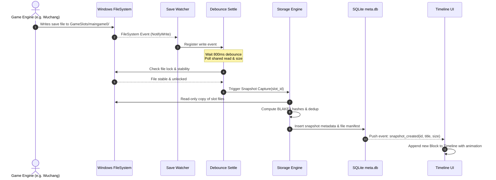
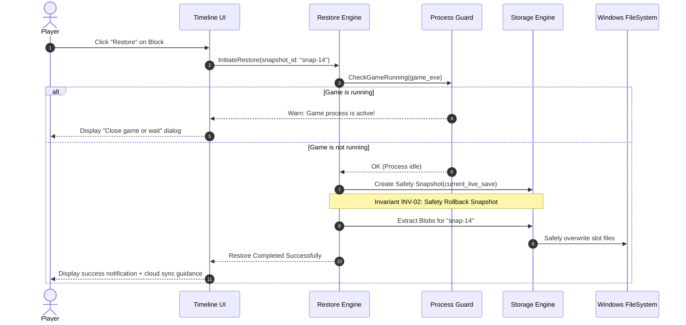

# Software Design Document (SDD)
## Save Rewind (Save-me) MVP Architecture & Technical Blueprint

---

## 1. System Overview & Problem Statement

**Save Rewind** is a zero-friction, non-invasive Windows desktop utility designed for story-driven, RPG, and Souls-like games (e.g., *Wuchang: Fallen Feathers*, *Elden Ring*, *Baldur's Gate 3*). It protects players from irreversible narrative consequences, missed quest branches, and ending locks by maintaining an automated, continuous version history of their game save states.

### Core Architectural Axioms
1. **Zero Interference with Live Game Saves**: The application monitors save folders strictly in read-only mode during gameplay. Original files are never modified, held open, or written to during snapshot capture.
2. **Debounced Quiescence (Settle-Before-Copy)**: Binary game saves are written in unpredictable chunks or temporary files. Capture triggers only after writes stabilize completely.
3. **Discrete "Line of Blocks" Visual Timeline**: Progress is rendered as a clean horizontal or vertical sequence of distinct blocks. Each block is an autonomous checkpoint with timestamp, auto-generated diff summary, user custom labels, and one-click rollback.
4. **Guaranteed Non-Destructive Restore**: Every restore operation is preceded by an automatic, atomic snapshot of the current state (`Pre-Restore Safety Rollback`).

---

## 2. High-Level Architecture (C4 Model)

```
+-----------------------------------------------------------------------------------------+
|                                    SAVE REWIND APP                                      |
|                                                                                         |
|  +-----------------------------------------------------------------------------------+  |
|  |                            PRESENTATION LAYER (UI)                                |  |
|  |   - "Line of Blocks" Timeline Component                                           |  |
|  |   - Slot Filter Tabs (Slot 0, Slot 1, Auto)                                       |  |
|  |   - Inline Snapshot Renaming & Pinning                                            |  |
|  |   - Safe Restore Confirmation Dialog & Cloud Sync Warning Modal                   |  |
|  |   - Global Hotkey Manager ("Quick Mark" Ctrl+Shift+S)                             |  |
|  +-----------------------------------------------------------------------------------+  |
|                                           |                                             |
|                                    IPC Bridge / API                                     |
|                                           |                                             |
|  +-----------------------------------------------------------------------------------+  |
|  |                             CORE APPLICATION ENGINE                               |  |
|  |                                                                                   |  |
|  |   +-----------------------+   +-----------------------+   +-------------------+   |  |
|  |   | Save Watcher &        |   | Diff Title Engine     |   | Safe Restore      |   |  |
|  |   | Debounce Listener     |   | (Auto "+12 KB" Labels)|   | Manager           |   |  |
|  |   +-----------------------+   +-----------------------+   +-------------------+   |  |
|  |               |                           |                         |             |  |
|  |               v                           v                         v             |  |
|  |   +-----------------------+   +-----------------------+   +-------------------+   |  |
|  |   | Content-Addressed     |   | SQLite Metadata       |   | Process Monitor   |   |  |
|  |   | Storage (CAS Engine)  |   | Index & Query Store   |   | (Game Lock Check) |   |  |
|  |   +-----------------------+   +-----------------------+   +-------------------+   |  |
|  +-----------------------------------------------------------------------------------+  |
+-----------------------------------------------------------------------------------------+
             |                                                                 |
             v (Read-only observation)                                         v (Controlled restore)
+------------------------------------+                       +------------------------------------+
|  OS FILE SYSTEM: GAME SAVE FOLDER  |                       |  APP INTERNAL DATA STORAGE         |
|  (e.g., %LOCALAPPDATA%\...         |                       |  - Blobs: %APPDATA%\SaveMe\blobs\  |
|   ...\GameSlots\maingame0\...)     |                       |  - Index: %APPDATA%\SaveMe\meta.db |
+------------------------------------+                       +------------------------------------+
```

---

## 3. Subsystem Breakdown

### 3.1 Save Watcher & Debouncing Engine
- **Purpose**: Reliably detect when the game flushes save data to disk without capturing truncated or in-flight writes.
- **Mechanism**:
  - Monitors the active target directory recursively using Windows file system events (`ReadDirectoryChangesW` / `notify`).
  - **The Settle-Verification Protocol**:
    1. On initial file modification event, schedule a debounce timer ($T_{debounce} = 800\text{ ms}$).
    2. Any subsequent write event resets the debounce timer.
    3. Once timer fires, the engine executes a **Quiescence Verification Poll**:
       - It attempts to open the candidate files with shared read access (`FILE_SHARE_READ`).
       - It records file length, waits $150\text{ ms}$, and verifies file length remains unchanged.
       - If the file is locked exclusively by the game process or file size is fluctuating, the timer re-arms for another $500\text{ ms}$.
    4. Only when both file size is static and shared read access is granted does the copy dispatch.

### 3.2 Content-Addressable Storage (CAS) & Manifests
- **Purpose**: Maximize disk efficiency and deduplication across hundreds of frequent saves.
- **Design**:
  - Each individual file within a save slot is hashed using **BLAKE3** (or SHA-256 fallback).
  - Blobs are stored at: `%APPDATA%\SaveMe\storage\blobs\<hash[0..2]>\<hash>`.
  - If a 40 MB save contains four 10 MB files, and only `player_stats.dat` (10 KB) changed, only the modified file is stored. The other unchanged files are referenced by their existing blob hashes.
  - Blobs are optionally compressed using **Zstandard (zstd)** at compression level 3 (fast, high ratio).

### 3.3 Diff Title Engine (Automatic Metadata Extraction)
- **Challenge**: Game save files are opaque binary blobs. For v1, reverse engineering binary save structures is out-of-scope and error-prone.
- **Solution**: The Diff Engine compares the new Snapshot Manifest ($S_t$) with the immediately preceding Snapshot Manifest ($S_{t-1}$) for the same game/slot:
  - Identifies which files were added, modified, or removed.
  - Computes byte size delta: $\Delta = \text{Size}(S_t) - \text{Size}(S_{t-1})$.
  - Formulates an intuitive, clean human-readable title:
    - `"Slot 0 updated (+12.4 KB)"`
    - `"Slot 0 progress saved (-2.1 KB)"`
    - `"Slot 1 initialized (450 KB)"`
  - Records elapsed play time since previous snapshot: `"4m after previous save"`.
  - Exposes an inline renaming control in the UI so the user can easily overwrite it with personal notes (e.g., *"Before talking to Fox Spirit"*).

### 3.4 SQLite Metadata Schema

The relational database (`meta.db`) tracks games, slots, snapshot manifests, and user pins.

```sql
-- Registered Games
CREATE TABLE games (
    id TEXT PRIMARY KEY,
    name TEXT NOT NULL,
    slug TEXT UNIQUE NOT NULL,
    watch_path TEXT NOT NULL,
    file_pattern TEXT DEFAULT '*',
    is_active INTEGER DEFAULT 1,
    created_at TIMESTAMP DEFAULT CURRENT_TIMESTAMP
);

-- Snapshot Checkpoints
CREATE TABLE snapshots (
    id TEXT PRIMARY KEY,
    game_id TEXT NOT NULL,
    slot_id TEXT NOT NULL,
    title TEXT NOT NULL,
    notes TEXT,
    size_bytes INTEGER NOT NULL,
    delta_bytes INTEGER DEFAULT 0,
    elapsed_seconds INTEGER DEFAULT 0,
    is_pinned INTEGER DEFAULT 0,
    is_auto INTEGER DEFAULT 1,
    is_safety_rollback INTEGER DEFAULT 0,
    created_at TIMESTAMP DEFAULT CURRENT_TIMESTAMP,
    FOREIGN KEY(game_id) REFERENCES games(id) ON DELETE CASCADE
);

-- Deduplicated Blobs
CREATE TABLE blobs (
    hash TEXT PRIMARY KEY,
    size_bytes INTEGER NOT NULL,
    compressed_size INTEGER NOT NULL,
    compression_algo TEXT DEFAULT 'zstd',
    ref_count INTEGER DEFAULT 1,
    created_at TIMESTAMP DEFAULT CURRENT_TIMESTAMP
);

-- Snapshot Manifest Entries (File Mapping)
CREATE TABLE snapshot_files (
    snapshot_id TEXT NOT NULL,
    relative_path TEXT NOT NULL,
    blob_hash TEXT NOT NULL,
    file_size INTEGER NOT NULL,
    PRIMARY KEY (snapshot_id, relative_path),
    FOREIGN KEY(snapshot_id) REFERENCES snapshots(id) ON DELETE CASCADE,
    FOREIGN KEY(blob_hash) REFERENCES blobs(hash)
);

CREATE INDEX idx_snapshots_game_slot ON snapshots(game_id, slot_id, created_at DESC);
CREATE INDEX idx_snapshots_pinned ON snapshots(game_id, is_pinned);
```

### 3.5 Safe Restore & Cloud Conflict Protocol

```
               SAFE RESTORE EXECUTION FLOW
+-------------------------------------------------------------+
| User clicks "Restore" on a historical block snapshot        |
+-------------------------------------------------------------+
                               |
                               v
+-------------------------------------------------------------+
| Check 1: Is the Game Process Running?                       |
|   - Query Windows toolhelp32 / process list for game EXE    |
|   - If running: prompt user to pause/exit game              |
+-------------------------------------------------------------+
                               |
                               v
+-------------------------------------------------------------+
| Step 2: Atomic Pre-Restore Safety Snapshot                  |
|   - Immediately capture current state of target save slot   |
|   - Store as "[Pre-Restore Safety Rollback]" with pin = 1   |
|   - Invariant: Zero progress lost even if restore was a     |
|     mistake!                                                |
+-------------------------------------------------------------+
                               |
                               v
+-------------------------------------------------------------+
| Step 3: Atomic Slot File Replacement                        |
|   - Read snapshot manifest for chosen checkpoint            |
|   - Stream blobs into a temporary staging folder            |
|   - Atomic swap / overwrite target save slot files          |
+-------------------------------------------------------------+
                               |
                               v
+-------------------------------------------------------------+
| Step 4: Cloud Sync Verification Advisory                    |
|   - Show prompt confirming restore success                  |
|   - Provide explicit instruction if Steam/Xbox Cloud is     |
|     active (e.g. disable cloud before launching game)       |
+-------------------------------------------------------------+
```

### 3.6 The "Line of Blocks" Presentation Model
The UI design is centered around the timeline representation:
- **Discrete Blocks**: Each snapshot is a distinct, card-like block connected by a progression line.
- **Card Elements**:
  - Slot Indicator Tag (`[Slot 0]`, `[Slot 1]`)
  - Timestamp (relative `5 mins ago` and exact `14:23:10`)
  - Title (Auto-generated diff or custom user name)
  - Pin icon toggle (persists checkpoint from retention cleanup)
  - Restore action button with safety preview
- **Color Aesthetics**:
  - Dark mode by default (`#0f172a` slate / `#1e293b` card background)
  - Accent colors: Emerald `#10b981` (active state), Cyan `#06b6d4` (pinned checkpoints), Amber `#f59e0b` (safety rollback blocks).

---

## 4. Sequence Diagrams

### 4.1 Save Write Capture Sequence



### 4.2 Safe Restore Sequence



---

## 5. Failure Modes & Mitigations Matrix

| Failure Mode | Risk Description | Architectural Mitigation |
| :--- | :--- | :--- |
| **Write In-Flight** | Copying files while the game is midway through flushing a 50 MB save produces corrupt snapshot. | **Quiescence Verification Poll**: Debounce timer + shared read check + 150ms size stabilization poll before reading. |
| **File Lock (`EACCES`)** | Game holds exclusive lock during save serialization. | Non-blocking retry with exponential backoff up to 3 seconds. App never throws hard errors; logs warning and retries. |
| **Game Running on Restore** | Player restores save while game is running; game memory overwrites files on exit or corrupts. | **Process Guard**: Scans process tree for target game executable and blocks restore with an explanatory modal until game exits. |
| **Accidental Bad Restore** | Player restores wrong snapshot and loses 3 hours of recent progress. | **Automatic Safety Rollback**: Before every restore, an instant `[Pre-Restore Safety Rollback]` snapshot is pinned to the timeline. |
| **Cloud Sync Overwrite** | Steam or Xbox Cloud detects out-of-sync local save timestamp and downloads cloud copy. | **Cloud Advisory Engine**: Detects cloud-enabled save folders, warns player, and displays step-by-step instructions to disable cloud sync during rewind testing. |
| **Disk Exhaustion** | 1,000 snapshots fill user's SSD. | **CAS Deduplication + Configurable Retention**: Unchanged files are stored once; retention policy prunes unpinned snapshots past threshold $N$ (default: 50). |

---

## 6. Performance Budget

- **Idle RAM Usage**: $\le 30\text{ MB}$.
- **CPU Usage during idle watching**: $< 0.1\%$.
- **Snapshot Capture Latency**: $< 850\text{ ms}$ for typical $10\text{ MB} - 50\text{ MB}$ save directories.
- **Restore Operation Time**: $< 5\text{ seconds}$.
- **UI Responsiveness**: 60 FPS scrolling and block interactions on timelines containing 500+ snapshots.
